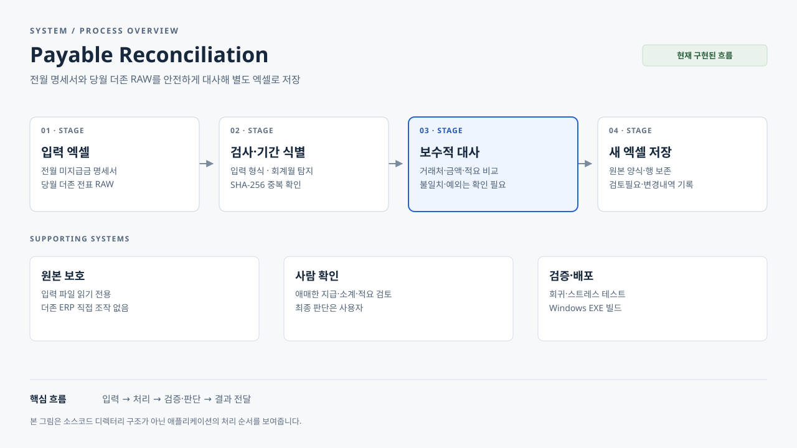

# 명세서 대사 프로그램

더존 iCUBE의 **당월 미지급금 계정 전표출력 Excel**과 **전월 말 거래처별 미지급금 명세서 Excel**을 대사해 당월 말 명세서 초안을 만들고, 사람이 확인해야 할 예외를 추리는 Windows용 로컬 도구입니다.

## 시스템 흐름



[확대해서 보기 (HTML)](docs/payable-reconciliation-architecture.html) · [SVG 원본](docs/payable-reconciliation-architecture.svg)

## 안전 원칙
- 더존 ERP를 직접 조작하거나 입력하지 않습니다.
- 입력 Excel은 읽기 전용으로 사용하며 덮어쓰지 않습니다.
- 결과는 항상 별도 Excel 파일로 저장합니다.
- 확실한 일치만 자동 대사하고, 중복·적요 불일치·미지급 등 애매한 건은 예외로 남깁니다.
- 실제 회사 데이터는 GitHub에 올리지 않습니다.

## 주요 기능
- 전월 말 명세서 + 당월 더존 전표출력 선택
- 거래처코드 + 금액 + 적요 기준 보수적 자동 대사
- 예외 중심 화면
- 전월 명세서의 상세 행과 서식을 유지하고, 당월 RAW 대변은 양수·차변은 음수로 추가해 별도의 당월 명세서 초안을 생성합니다.
- **거래처 소계는 전월 상세 합계 + 당월 대변 − 당월 차변**으로 계산합니다. 검증된 순잔액의 자동 대사는 개별 청구 건별 지급 배분까지 확정하는 뜻은 아닙니다.
- 금액 열 오른쪽 빈 열에 처리상태와 검토 이유를 표시합니다. 부분지급·거래처명 차이·소계 불일치 등도 원본 내역을 보존하며 확인필요로 표시합니다.
- 소계의 단순 `SUM(금액열 상세범위)`와 `=-170000`, `=-(170000)` 같은 상수 수식은 직접 계산합니다. 공백·괄호·후행 마이너스·전각 문자·통화기호가 섞인 명확한 음수 표기도 숫자로 읽습니다. 숫자 사이가 끊긴 값이나 알 수 없는 수식은 자동 확정하지 않습니다.
- 거래처를 명확히 식별한 명세서 입력 오류는 해당 거래처만 자동 반영을 보류합니다. 거래처 미상 또는 RAW 입력 오류 행은 대사에서 제외하고 `입력 확인`·`검토필요`에 남기되, 나머지 대사는 중단하거나 전체 보류하지 않습니다.
- `대사내역`·`검토필요`·`변경내역`으로 판단 근거와 출처를 추적합니다. `원본행` 링크로 생성된 당월 명세서의 해당 거래 행으로 이동할 수 있습니다.
- 저장 완료 후 Windows 탐색기로 저장 폴더를 자동으로 엽니다.

## Windows 다운로드

정식 최신 배포의 파일은 다음 두 가지입니다.

- [PayableRecon.zip](https://github.com/hooya92/payable-reconciliation/releases/download/download-latest/PayableRecon.zip) — 압축을 풀면 **PayableRecon.exe + 사용설명서.txt** 두 파일
- [PayableRecon.exe](https://github.com/hooya92/payable-reconciliation/releases/download/download-latest/PayableRecon.exe) — 실행파일만 필요한 경우

GitHub Release는 한글 이름을 가진 첨부파일을 자동으로 바꿀 수 있으므로, 설명서의 **정확한 한글 파일명은 ZIP 안에 보존**합니다.
설명서는 [저장소에서도 바로 확인](docs/사용설명서.txt)할 수 있습니다.
개발 브랜치의 테스트 프로그램은 별도 `month-end-preview` Release에서 제공합니다.

## 실행
```bash
python -m venv .venv
.venv\Scripts\activate
pip install -r requirements.txt
python app.py
```

## 테스트
```bash
python -m unittest discover -s tests -v
```

> 현재는 실제 회사 파일이 아닌 합성 데이터 기준으로 개발합니다. 첫 실파일 검증에서 더존/명세서 헤더 구조와 업무 예외를 확인한 뒤 규칙을 보강합니다.


## 악성 가상 Excel 직접 생성
실제 회사 자료 없이 지저분한 입력/애매한 대사 케이스를 눈으로 확인하려면:

```bash
python -m tests.synthetic_adversarial_factory
```

프로젝트 아래 `synthetic_adversarial/` 폴더에 가상 `.xlsx` 두 개가 생성됩니다. 생성 파일은 Git에서 무시되며 회사 데이터는 포함하지 않습니다.


## 정상 가상 더존 Raw 생성
실제 더존 Raw 파일이 없어도 UI/대사 흐름을 확인할 수 있도록 정상 가상 Raw를 만들 수 있습니다.

```bash
python -m tests.synthetic_douzone_raw_factory
```

프로젝트 아래 `synthetic_raw/더존_Raw_정상_2026_1년.xlsx`가 생성됩니다. 더존 전표출력 형태처럼 두 개의 `코드` 열을 사용하고, 여러 월의 전표와 25301 외 계정도 섞어 대상월/계정 필터를 확인할 수 있게 구성되어 있습니다.

### 검토 범위와 잔액 확인

- 오발행·취소 의심은 관련 금액·적요 후보만 검토하고, 같은 거래처의 무관한 정상 거래는 기존 대사를 유지합니다. 관련 건이 불명확하면 거래처 단위 확인을 유지합니다.
- 확인 사유에는 서로 다른 거래처명·적요와 원본 파일·행 또는 입력 항목·원본값을 표시합니다.
- `당월 잔액검증`에서 전월 잔액 + 당월 대변 − 당월 차변, 생성 잔액, 계산 차액을 확인합니다. RAW에 유효한 연속 `잔액`이 있으면 제공 범위의 원장 잔액·차액도 비교합니다. 계산 일치와 원장 일치는 별개이며, 잔액 미제공·누락·수식·입력 오류, 또는 일부 계정에 해당 거래처 거래가 없을 때에는 원장 비교를 확정하지 않습니다. 전월 파일에 같은 이름의 시트가 있어도 이름을 바꾸지 않습니다.
